# Color Flow

**Color Flow** is a Glyphs 3 palette plugin that turns the twelve native **Layer Color Labels** into a customizable, gamified workflow. Assign a meaning to each colour, tick the steps off in the sidebar, and watch colour-coded progress bars fill as your font moves from *outline* to *done*. A built‑in, offline **progress report** gives you a font‑wide picture — coverage, a per‑glyph heatmap, a burndown timeline with forecasts, and a day‑by‑day Time Machine.

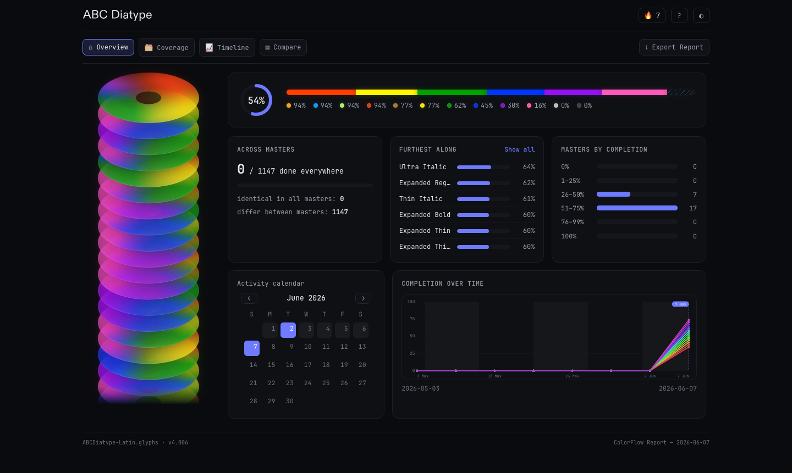

> The wide screenshots above and below come from the plugin's **HTML report**. Screenshots of the palette UI itself are coming soon.

---

# Glyph Color 🆚 Layer Color

In Glyphs, color labels can be defined on two levels — **Glyph** and **Layer** — in one of twelve predefined colors.

* **Set Glyph Color** — control‑click / right‑click a glyph.
* **Set Layer Color** — right‑click a glyph while holding Option.

Glyph Color spans the whole glyph cell. Layer Color is drawn on the right half of the cell when a Glyph Color is also set, or across the whole cell with a cut‑out in the top‑left when no glyph color is set.

| Glyph Color | Layer Color | Glyph + Layer Color |
| :---: | :---: | :---: |
| 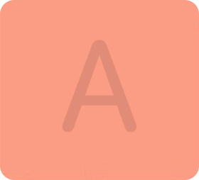 |  |  |

Color Flow reads the **Layer Color** to track the progress of each layer, for example:

* 🟣 → Outline corrected
* 🟢 → Anchors placed
* 🔵 → Spacing set
* 🟡 → Ready to export

---

# Requirements

Color Flow needs a `colorNames.txt` file in **either** `~/Library/Application Support/Glyphs 3/info` **or** the same folder as the current Glyphs source. The latter wins, so the labelling can travel with the `.glyphs` file and stay in sync between collaborators.

The file uses `colorName=meaning`, one per line, no spaces around the `=`:

```
red=Step 1
orange=Step 2
brown=Step 3
yellow=Step 4
lightGreen=Step 5
darkGreen=Step 6
lightBlue=Step 7
darkBlue=Step 8
purple=Step 9
magenta=Step 10
lightGray=Step 11
charcoal=Step 12
```

---

# Customize

The point of Color Flow is that the **meaning and order** of colours are yours. Reorder by moving lines; hide a colour by leaving its meaning blank:

```
red=
orange=
brown=
purple=Outline corrected
lightGreen=Anchors placed
darkGreen=
lightBlue=Spacing set
darkBlue=
yellow=Ready to Export
magenta=
lightGray=
charcoal=
```

Resulting workflow in the palette:

* 🟣 → Outline corrected
* 🟢 → Anchors placed
* 🔵 → Spacing set
* 🟡 → Ready to Export

---

# How it works

Each layer carries its own Color Flow state, shown in the panel. Layer Color Labels are set automatically from the **order** of the checked steps: the colour applied is the one **preceding the first unchecked step**.

In the example below the Layer Color is `Orange` — even though `Light Green` and `Yellow` are ✅, `Brown` is unchecked, so the colour falls back to the step before it.

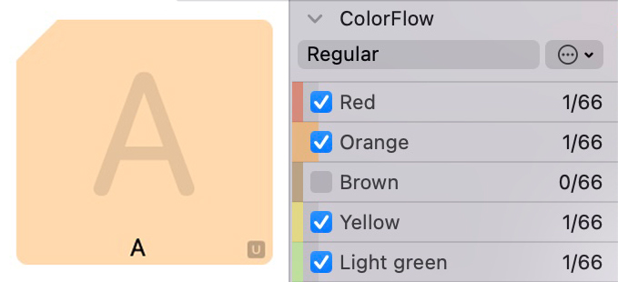   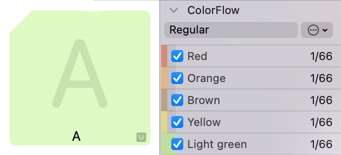

> **Palette UI screenshots coming soon** — drag‑to‑reorder colours, double‑click‑to‑rename labels, and focus mode.

### Shortcuts

The palette registers a native **Jump to next color glyph** command that opens the next glyph that still needs work. Assign it a key in *Glyphs → Settings → Shortcuts* (search "Color Flow") — no extra install needed.

The same jump is also available as a script: install **"Color Flow Shortcut"** from *Window → Plugin Manager* and reload the scripts folder with `⌥ ⇧ ⌘ Y`.

---

# The progress report

A contemporary, **fully offline** report for the whole font, opened from the palette's **Action Button (⋯) → Open Color Font Dashboard**. It is a single self‑contained HTML file — no internet, no install — that you can keep or share. When it finishes building you get **Open** and **Save** buttons.

Everything it shows matches the palette exactly: same glyphs, same Layer Color source, same counting.

### Progress at a glance

A stacked, colour‑coded completion bar (per font and per master) with a completion ring and a glowing colour‑dot legend.

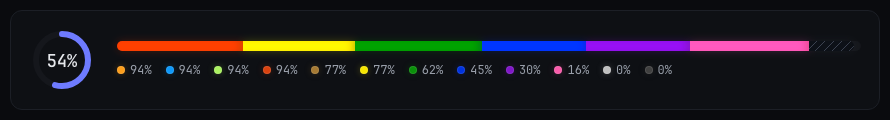

### Coverage

How your colours are spread **by category** and **by writing system / script**, each script shown as a sample‑glyph card.

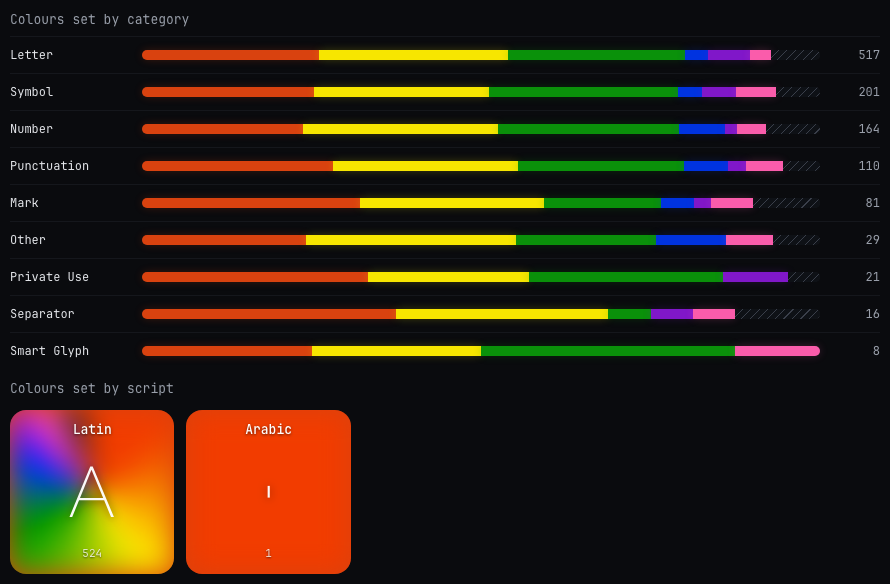

### Per‑glyph heatmap

Every glyph drawn as its own letterform, tinted by the step it's currently on. Hover a glyph for its step journey; click to open it in Glyphs.

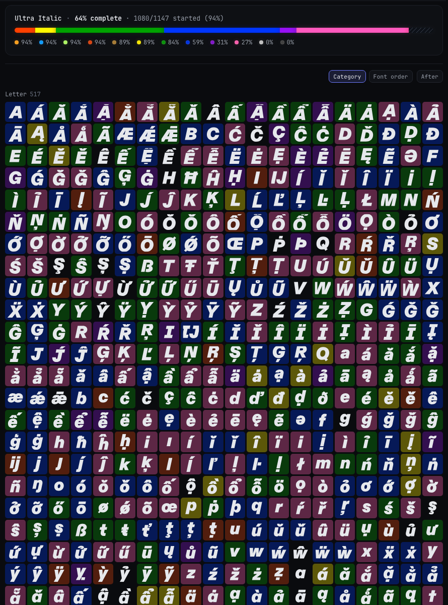

### Timeline & forecast

A burndown of completion over time with **Line** and **Flow** (colour streamgraph) modes, a this‑week digest, per‑category and per‑script lanes, a regression log, and a per‑master **finish‑date forecast** (velocity + ETA + confidence).

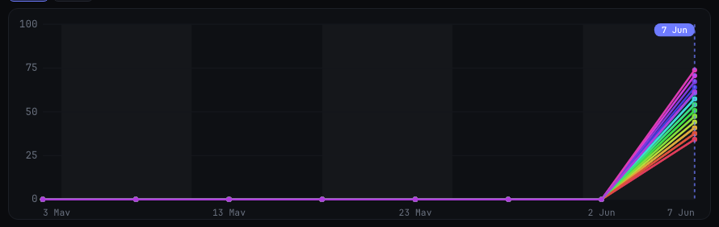

The activity calendar and the completion chart sit side by side on the Overview:

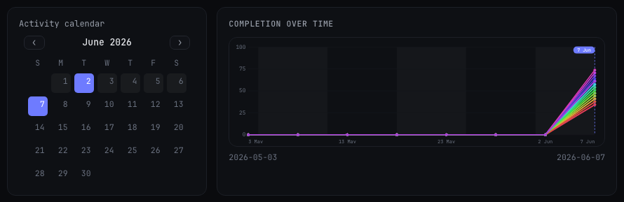

### Time Machine

Replay your font's colouring **day by day**. Drag the scrubber — it has a tick per day, labelled by date — and the glyph grid fades back to the colour state on that date.

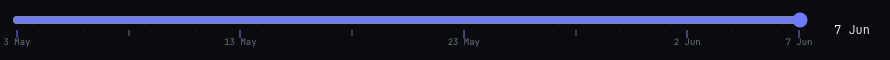

> **Backfill from Git** — normally the timeline fills in one day at a time, as you run the report. If your `.glyphs` / `.glyphspackage` lives in a **git repository**, Color Flow reconstructs the history straight from your past commits (one snapshot per day) — so the timeline is populated immediately instead of having to wait days. It runs automatically for git‑tracked fonts and is incremental, so only the first run does the heavy lifting.

### Compare

A steps × masters matrix to see which master lags on which step. A fully‑complete cell shows ✅.

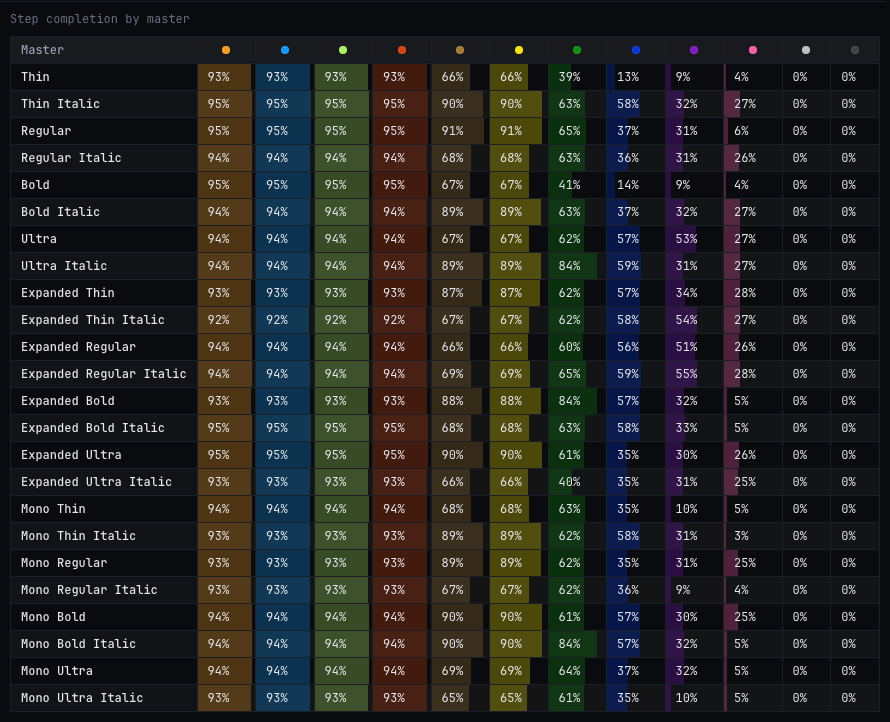

### Also

* **Light & dark** — follows your system, with a one‑click toggle that remembers your choice.
* **Export** — the report data as **CSV / JSON / PDF**.
* **Changed since last run** — glyphs whose colour changed since the previous report; the snapshot lives in Glyphs' preferences, never in your `.glyphs` file.

---

# Rainbow Font View

Color Flow can reorder the **Font View** into labelled colour sections, using the same `colorNames.txt` labels and order. Toggle it from **File → Color Flow: Rainbow Font View** (a checkmark shows the state) or the palette's Action Button.

It is **non‑destructive**: your original glyph order is backed up when you enable it and restored when you disable it. The "None" bucket (glyphs with no colour) is always placed last.

> This feature merges the former **Rainbow FontView** plugin into Color Flow. If you still have the standalone *Rainbow FontView* plugin installed, **disable or remove it** — otherwise both will fight over the Font View order. Color Flow warns you once if it detects the old plugin.

---

# Rename labels inline

**Double‑click a label** in the palette to edit it in place; press Return to save. Single‑click still toggles the step. The new name is written straight to `colorNames.txt`, so the palette, the keyboard shortcuts, and the Rainbow Font View sections all relabel immediately.

---

# Extra features (Action Button ⋯)

* **Setup Color Flow based on Color Layers** — derive each layer's Color Flow state from its existing Layer Color (handy the first time you open a `.glyphs` file that already has colours).
* **Generate Color Flow Smart Filters** — add a "Color Flow" folder of filters that sort layers by which step is / isn't set.
* **Copy Color Flow to Master** — copy state from one master to another.
* **Toggle Rainbow Font View** — group the Font View into colour sections.
* **Rainbow Source: Layer / Glyph Color** — choose which colour the grouping reads.
* **Open Color Font Dashboard** — build the progress report described above.

---

# Install

Install **Color Flow** (and optionally **Color Flow Shortcut** for the script version of the jump shortcut) from **Window → Plugin Manager**, then restart Glyphs. Make sure a `colorNames.txt` is in place (see *Requirements*).

---

*Thanks to Gor Jihanian ([@gorjious](https://github.com/gorjious)) for his contribution.*
